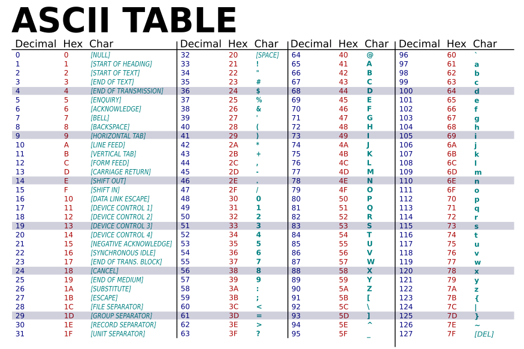

---
# 1. 기본 정보 및 SEO
title: "비트와 데이터"
description: "비트와 데이터에 대해서 다룬다"
slug: "CS/ch01/bits"
authors: unani

# 2. 작성일 및 상태 제어
date: 2026-11-18 08:27
draft: false

# 3. 사이드바 및 네비게이션 제어
sidebar_label: "[CS] 비트와 데이터"
#sidebar_position: 1

# 4. 분류 및 메타데이터
tags: [CSAPP, Bit, Byte, Data, Context]
keywords: [CSAPP, Bit, Byte, Data, Context]
#image: ""
---

# 비트와 데이터

## 데이터는 비트와 컨텍스트(맥락)로 이뤄진다

컴퓨터는 문자를 고유한 바이트 크기의 정수값으로 표현하는 ASCII 표준을 사용해 문자를 표현한다.

{/*truncate*/}

아스키 문자로만 구성된 파일을 텍스트 파일, 그 외의 모든 파일은 바이너리 파일(Binary File)이라고 부른다.
시스템의 모든 데이터는 비트로 표현된다.
데이터를 해석하는 맥락(context)에 따라 동일한 비트 시퀀스가 정수, 실수, 문자열, 기계어 등으로 다르게 인식된다.
