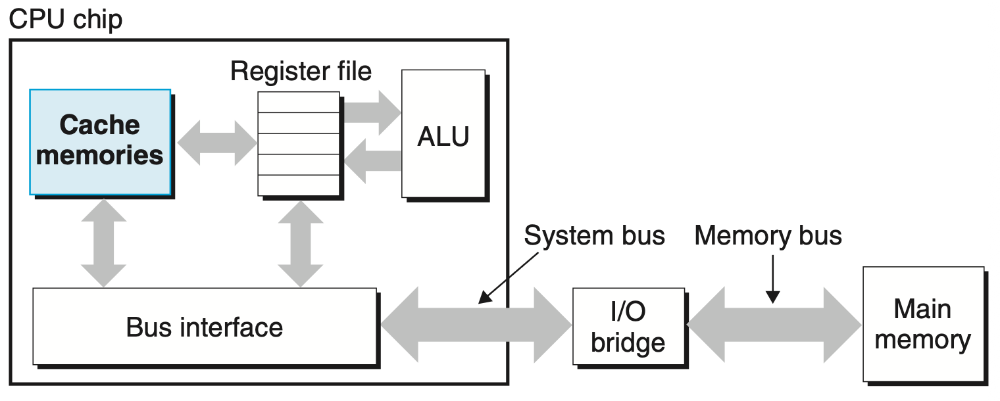
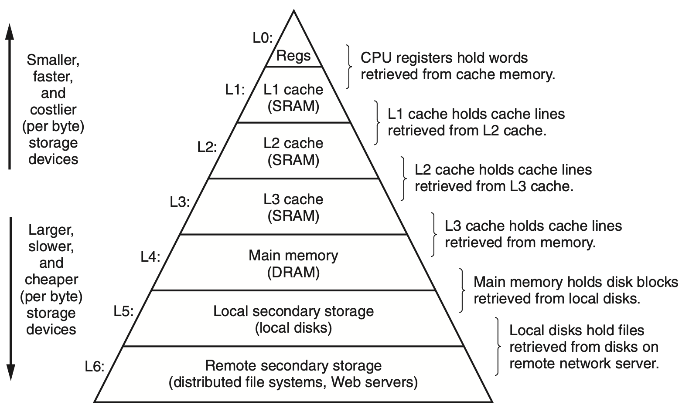

---
# 1. 기본 정보 및 SEO
title: "캐시가 중요한 이유"
description: "컴퓨터에서 캐시가 중요한 이유에 대한 글"
slug: "/CS/ch01/cache"
authors: unani

# 2. 작성일 및 상태 제어
date: 2026-11-19 21:53
draft: false

# 3. 사이드바 및 네비게이션 제어
sidebar_label: "[CS] 캐시"
#sidebar_position: 1

# 4. 분류 및 메타데이터
tags: [CSAPP, Cache, Memory]
keywords: [CSAPP, Cache, Memory]
#image: "/img/social-card.png"
---

# 캐시가 중요한 이유

시스템이 데이터를 이동하는데에 많은 시간을 쓴다.
이런 복사 작업의 상당 부분은 프로그램의 '실제 작업'을 낮추는 오버헤드(overhead)다.
따라서 시스템 설계자의 주요 목표 중 하나는 이런 복사 연산을 가능한 빠르게 수행하도록 하는것이다.

{/*truncate*/}

전형적인 레지스터 파일은 수백 바이트의 정보만 저장한다.
하지만 프로세서는 레지스터 파일에서 데이터를 수백 배 이상 빠르게 읽을 수 있다.

프로세서-메모리 간의 속도 차이가 나는 문제에 대응하기 위해 사용할 가능성이 높은 데이터를 캐시 메모리(Cache Memroy)라고 하는 저장 장치를 도입한다.

  

프로세서 칩 위에 있는 L1 캐시는 수만 바이트를 보관할 수 있고, 레지스터 파일과 거의 비슷한 속도로 접근할 수 있다.
L1 캐시보다 더 큰 용량의 L2 캐시는 전용 버스로 프로세서에 연결된다.
프로세서가 L2 캐시에 접근하는 시간은 L1 캐시보다 더 오래 걸리지만, 메인 메모리에 접근하는것 보다는 5~10배 이상 빠르다.
L1, L2 캐시는 정적 램(SRAM, Static Random Access Memroy)라고 불리는 하드웨어 기술로 구현된다.

캐싱(Chaching)의 핵심 아이디어는 프로그램이 국소 영역의 데이터와 코드에 접근하려는 경향인 지역성을 활용함으로써 큰 메모리와 빠른 메모리의 효과를 동시에 얻을 수 있다는 것이다.
자주 접근할 가능성이 높은 데이터를 보관하도록 캐시를 구성하면, 대부분의 메모리 연산을 캐시를 이용해 수행할 수 있다.

메모리 계층의 예시

Chapter06에서 메모리와 같은 장치들과 이를 활용하는 방법에 대해 다룬다.
