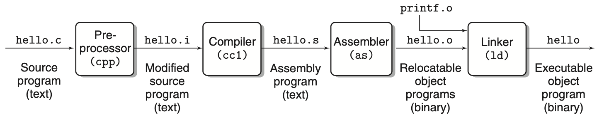

---
# 1. 기본 정보 및 SEO
title: "프로그램은 다른 프로그램에 의해 다양한 형태로 번역된다."
description: "컴파일 시스템의 동작에 대한 글"
slug: "/CS/Chapter01/compilation_system"
authors: unani

# 2. 작성일 및 상태 제어
date: 2026-11-19 09:00
draft: false

# 3. 사이드바 및 네비게이션 제어
sidebar_label: "[CS] 컴파일 시스템"
# sidebar_position: 1

# 4. 분류 및 메타데이터
tags: [CSAPP, C, Assembly, Preprocessor, Compiler, Assembler, Linker]
keywords: [CSAPP, C, Assembly, Preprocessor, Compiler, Assembler, Linker]
# image: "/img/social-card.png"

pagination_prev: blog/bits
pagination_next:
---

# 프로그램은 다른 프로그램에 의해 다양한 형태로 번역된다

C 언어와 같이 인간이 읽고 이해하기 쉬운 고수준의 언어로 작성된 프로그램은 실행하기 위해서는 컴퓨터가 이해할 수 있는 저수준 언어(기계어) 시퀀스로 번역된다.
번역된 명령어들은 실행 가능한 오브젝트 프로그램(executable object program)의 형태로 패키징되어 바이너리 파일의 형태로 저장된다.

{/*truncate*/}

고수준에서 저수준 언어로 번역하는 프로그램을 컴파일러라고 한다.
(유닉스 시스템에서는 gcc라는 컴파일러가 사용된다.)

C 파일을 기계어로 번역해 컴퓨터에서 실행하기 위해서는 다음의 네 단계를 거치게 된다. 이 각 단계를 수행하는 프로그램들(전처리기, 컴파일러, 어셈블러, 링커)을 통틀어 컴파일 시스템이라고 부른다.

{/*truncate*/}

## 컴파일러의 동작 과정

1. 전처리 단계(Preprocessing phase) \
   전처리기는 # 문자로 시작하는 지시어에 따라 원래의 C프로그램(`.c`)을 수정한다. \
   (`#include <stdio.h>` 명렁어는 전처리기에 의해 `stdio.h` 헤더파일의 내용을 프로그램에 직접 삽입한다.) \
   결과물로 `.i` 확장자 파일을 생성

2. 컴파일 단계(Compilation phase) \
   컴파일러는 `.i` 파일을 어셈블리어 프로그램을 담고 있는 텍스트 파일로 번역한다. \
   결과물로 `.s` 확장자 파일을 생성

3. 어셈블 단계(Assembly phase) \
   어셈블러는 `.s` 파일을 기계어 명령어로 번역하고 relocatable object program(재배치 가능 오브젝트 프로그램)이라는 형태로 패키징 해 저장한다. \
   이 파일은 `main` 함수의 명령어를 인코딩하기 위한 17바이트를 담고 있는 바이너리 파일이다. \
   결과물로 `.o` 확장자 파일을 생성

4. 링킹 단계(Linking phase) \
   링커는 재배치 가능 오브젝트 프로그램(`.o`)들을 병합해 메모리에 로드되어 실행될 준비가 된 실행 파일을 생성한다.
