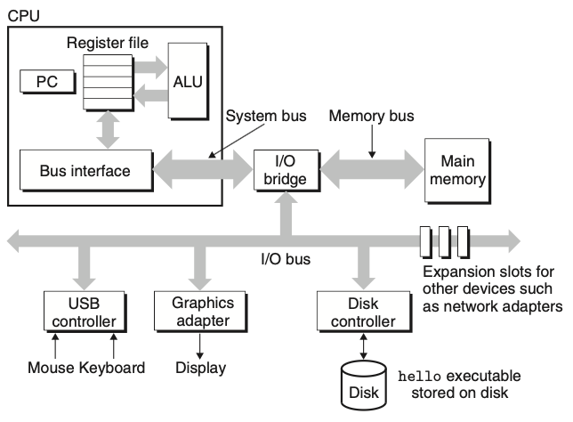
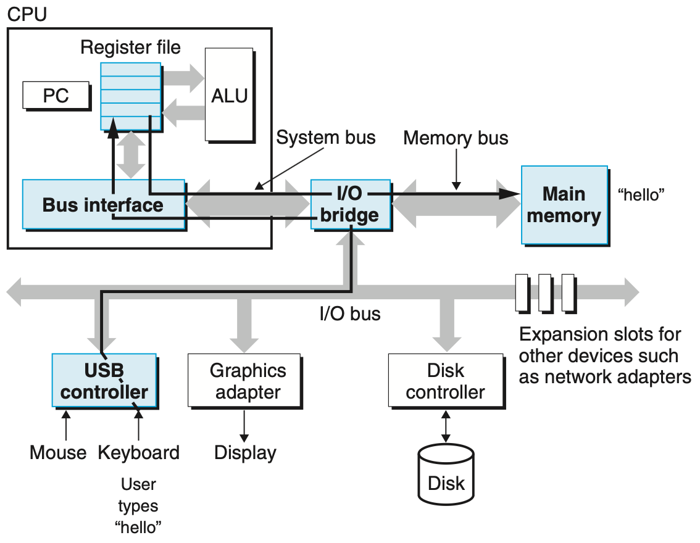
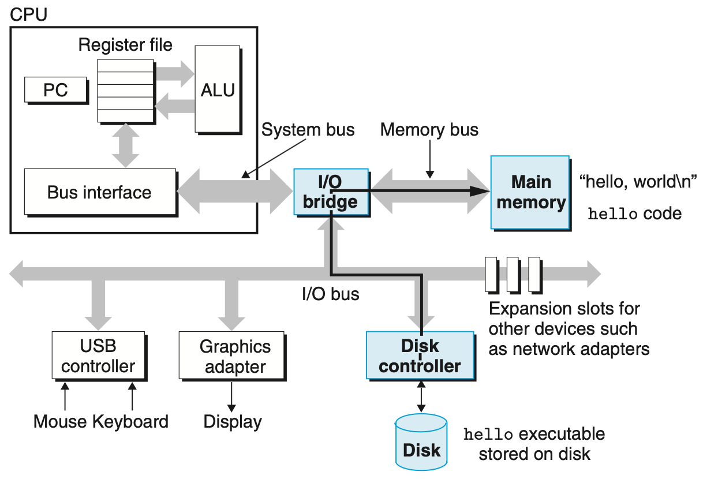

---
# 1. 기본 정보 및 SEO
title: "컴퓨터 시스템"
description: "프로세서는 메모리에 저장된 명령어를 읽고 해석한다."
slug: "/CS/Chapter01/computer_system"
authors: unani

# 2. 작성일 및 상태 제어
date: 2026-11-19 14:26
draft: false

# 3. 사이드바 및 네비게이션 제어
sidebar_label: "[CS] 컴퓨터 시스템"
#sidebar_position: 1

# 4. 분류 및 메타데이터
tags:
  [CSAPP, Bus, I/O, Memory, RAM, CPU, Processor, Register, Program Counter, ALU]
keywords:
  [CSAPP, Bus, I/O, Memory, RAM, CPU, Processor, Register, Program Counter, ALU]
#image: "/img/social-card.png"
---

# 컴퓨터 시스템

유닉스 시스템에서 C 언어를 컴파일 해서 나온 실행 파일을 실행하기 위해, shell에서 실행파일을 입력해야한다.
셸은 프롬프트를 출력하고, 명령어를 입력하고, 해당 명령을 수행하는 명령어 해석기 이다.(Command Line Interface)

{/*truncate*/}

## 시스템의 하드웨어 구조

프로그램을 실행할 때 어떤 일이 일어나는지 이해하려면 전형적인 시스템의 하드웨어 구조를 이해해야 한다.
대부분의 시스템은 비슷한 형태와 성격을 갖는다.

<p align="center">
  
</p>

### 버스(Buses)

시스템에는 버스라고 불리는 통로가 있고, 컴퓨터 시스템의 각 구성요소는 버스를 통해 바이트 단위의 정보(`words` : 워드)를 주고 받는다.

워드는 시스템 마다 그 크기가 고정되어 있다.
일반적으로 `32 Bit`(`4 Byte`) 또는 `64 Bit`(`8 Byte`)의 워드 크기를 갖는다.

### 입출력 장치(I/O Device)

입출력 장치는 외부와 연결되는 시스템의 통로이다.
각 IO 장치는 컨트롤러 또는 어댑터를 통해 IO버스에 연결된다. \
(컨트롤러 : 메인보드에 내장되어 있음. | 어댑터 : 메인보드 슬롯에 꽂는 형태) \

컨트롤러와 어댑터의 목적은 IO 버스와 IO 장치 간 정보를 양방향으로 주고 받는것이다.

### 메인 메모리(Main Memroy)

메인 메모리는 프로세서가 프로그램을 실행하는 동안 프로그램과 프로그램이 다루는 데이터를 모두 담고 있는 임시 저장장치이다. \
물리적으로는 DRAM(Dynamic Random Access Memory)에 저장된다. \
논리적으로 메모리는 0부터 시작하는 주소를 갖는 바이트들의 배열로 구성된다.

Chapter06에서 메모리의 작동, 구성에 대해서 다룬다.

### 프로세서(Processor)

중앙 처리 장치(CPU, Central Processing Unit)은 메인 메모리에 저장된 명령어를 실행한다.
CPU는 프로그램 카운터(PC, Prgram Couter)라고 불리는 워드 크기의 저장장치(또는 레지스터)가 있다.
PC는 메인 메모리에 있는 어떤 기계어 명령어를 가리킨다.(해당 명령어의 주소를 담고 있음)

프로세서는 PC가 가리키는 메모리에서 명령어를 읽고, 명령어 안의 비트를 해석해 연산을 수행한뒤 다름 명령어를 가리키도록 PC를 갱신한다.

이러한 작업은 메인 메모리, 레지스터 파일, 산술 논리 장치(ALU, Arithmetic Logic Unit)을 중심으로 이뤄진다. \
레지스터 파일은 고유한 이름을 각각 가진 워드 크기 레지스터들의 모음으로 구성된 작은 저장장치다. \
ALU는 새로운 데이터 값과 주소 값을 계산한다.

---

<p align="center">CPU가 수행할 수 있는 연산들의 예시</p>

- Load : 메인 메모리에서 바이트나 워드를 복사해 레지스터에 넣고, 레지스터의 기존 내용을 덮어쓴다.
- Store : 레지스터에서 메인 메모리의 한 위치로 바이트나 워드를 복사해, 그 위치의 기존 내용을 덮어쓴다.
- Operate : 두 레지스터의 내용을 ALU로 복사하고, 두 워드에 대한 산술 연산을 수행한 뒤, 그 결과를 레지스터에 저장해 레지스터의 기존 내용을 덮어쓴다.
- Jump : 명령어 자체에서 한 워드를 추출해 PC에 복사함으로써 PC의 기존 값을 덮어쓴다.

---

실제 최신 프로세서는 더 복잡한 메커니즘을 사용한다.

Chapter03에서 기계어를 학습할 때 기계의 명령어 집합 구조가 제공하는 추상화를 다룬다. \
Chapter04에서 프로세서가 실제 구현되는 방식에 대해 다룬다. \
Chapter05에서 기계어 프로그램의 성능을 예측하고 최적화 할 수 있게 해주는 최신 프로세서 작동 모델에 대해 다룬다.

## hello 프로그램의 실행

`hello.c`

```C
#include <stdio.h>

int main() {
  printf("hello, world\n");
  return 0;
}
```

shell에서 hello 프로그램을 실행하기 위한 명령어(`./hello`)를 입력하면 다음의 그림에서 처럼 각 문자를 레지스터로 읽어들인 뒤 메모리에 저장한다.

<p align="center">
  
</p>

`Enter`키를 누르면, shell은 hello 오브젝트 파일에 있는 코드와 데이터를 디스크에서 메인 메모리로 복사해 실행 가능한 `hello`파일을 로드한다.

직접 메모리 접근(DMA, Direct Memory Access) 기법을 사용하면, 데이터가 프로세서를 거치지 않고 디스크에서 메인 메모리로 직접 이동한다.

<p align="center"></p>

`hello` 오브젝트 파일의 코드와 데이터가 메모리에 로드되고 나면, 프로세서는 hello 프로그램의 `main` 루틴에 있는 기계 명령어들을 실행한다.
이 명령어들은 `hello, world\n` 문자열의 바이트들을 메모리에서 레지스터 파일로 복사하고, 디스플레이 장치로 복사해 화면에 표시한다.

<p align="center">
  
</p>
