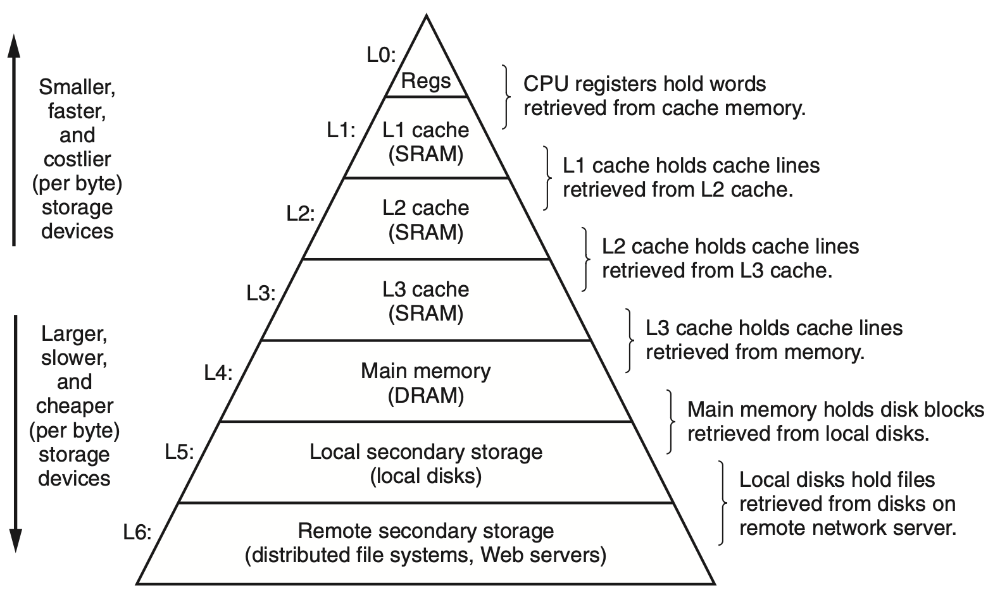

---
# 1. 기본 정보 및 SEO
title: "저장 장치"
description: "저장 장치의 계층에 대한 내용을 다룬다."
slug: "/CS/ch01/storage"
authors: unani

# 2. 작성일 및 상태 제어
date: 2026-11-19 23:57
draft: false

# 3. 사이드바 및 네비게이션 제어
sidebar_label: "[CS] 저장 장치"
#sidebar_position: 1

# 4. 분류 및 메타데이터
tags: [CSApp, Storage, Memeory, Cache]
keywords: [CSApp, Storage, Memeory, Cache]
#image: "/img/social-card.png"
---

# 저장 장치

저장장치는 계층을 이룬다.
프로세서와 느린 장치(Main Memory) 사이 더 작고 빠른 저장장치(ex. Chache Memeory)를 사용한다.

대부분의 시스템의 저장 장치는 계층 구조를 가지고 구성된다.
계층의 위에서 아래로 내려갈수록 장치들은 느려지고, 더 커지고, 데이터의 크기당 비용은 저렴해진다.

{/*truncate*/}

- 레지스터 파일은 L0(Level 0)을 차지한다.
- 캐시 메모리는 L1 ~ L3 까지의 단계를 차지한다.
- 메인 메모리는 L4를 차지한다.

메모리 계층 구조의 핵심 아이디어는 **한 계층의 저장 장치가 바로 다음 하위 계층 저장장치의 캐시 역할을 한다**는 것이다. \
분산 파일 시스템을 사용하는 네트워크 시스템에서는 로컬 디스크가 캐시 역할을 하기도 한다.
