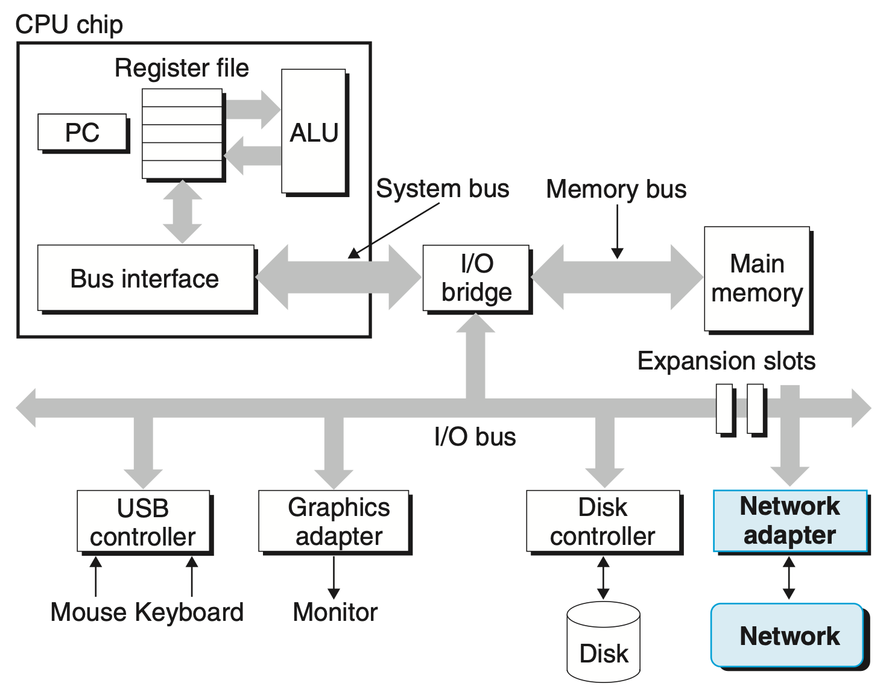

---
# 1. 기본 정보 및 SEO
title: "네트워크"
description: "시스템과 네트워크에 대한 내용을 다룬다."
slug: "/CS/ch01/Network"
authors: unani

# 2. 작성일 및 상태 제어
date: 2026-11-20 13:32
draft: false

# 3. 사이드바 및 네비게이션 제어
sidebar_label: "[CS] 네트워크"
#sidebar_position: 1

# 4. 분류 및 메타데이터
tags: [System, Network, Network Adapter, I/O Device]
keywords: [System, Network, Network Adapter, I/O Device]
#image: "/img/social-card.png"
---

# 시스템은 네트워크를 통해 다른 시스템과 통신한다

네트워크는 I/O 장치로 볼 수 있다.
시스템이 메인 메모리에서 네트워크 어댑터(Network Adapter)로 바이트의 연속을 복사할 때, 데이터는 네트워크를 통해 다른 시스템으로 이동한다.
마찬가지로 시스템은 네트워크를 통해 들어온 데이터를 메인 메모리로 복사할 수 있다.

{/*truncate*/}

  

[네트워크도 I/O 장비로 취급한다]

---

  

  [telnet을 이용해 네트워크를 통해 원격으로 `hello` 프로그램 실행하기]

