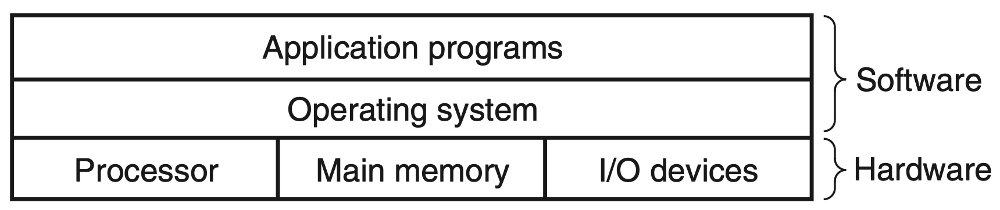
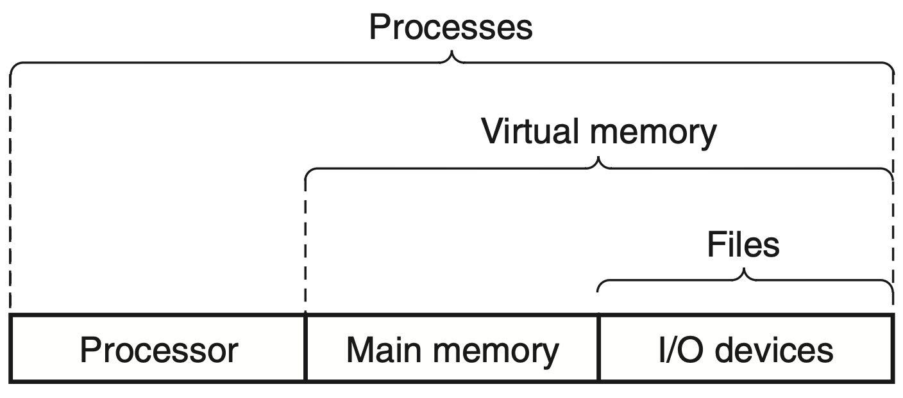
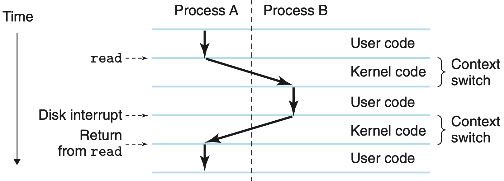
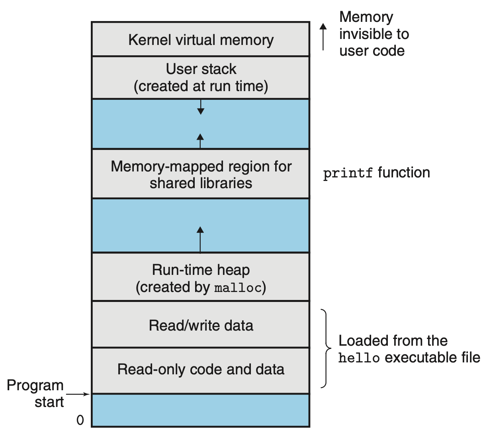

---
# 1. 기본 정보 및 SEO
title: "운영체제"
description: "하드웨어를 관리하는 운영체제에 대하여"
slug: "/CS/Chapter01/operating_system"
authors: unani

# 2. 작성일 및 상태 제어
date: 2026-11-20 10:36
draft: false

# 3. 사이드바 및 네비게이션 제어
sidebar_label: "[CS] 운영체제"
#sidebar_position: 1

# 4. 분류 및 메타데이터
tags:
  [
    Operating System,
    OS,
    Hardware,
    Abstract,
    Process,
    Processor,
    I/O Device,
    CPU,
    Context Switching,
    Virtual Address Space,
    Virtual Memory,
    Heap,
    User Stack,
  ]
keywords:
  [
    Operating System,
    OS,
    Hardware,
    Abstract,
    Process,
    Processor,
    I/O Device,
    CPU,
    Context Switching,
    Virtual Address Space,
    Virtual Memory,
    Heap,
    User Stack,
  ]
#image: "/img/social-card.png"
---

# 운영체제

운영체제는 응용 프로그램과 하드웨어 사이 개입된 소프트웨어 계층으로 볼 수 있다.
하드웨어를 조작하려는 응용 프로그램의 모든 시도는 반드시 운영체제를 거쳐야 한다.

{/*truncate*/}

[컴퓨터 시스템의 레이어들]

  

## 운영체제의 목적

1. 응용 프로그램이 하드웨어를 잘못 사용해 손상시키는 것으로부터 하드웨어를 보호하는 것
2. 저수준 하드웨어 장치를 조작하기 위한 단순하고 통일된 메커니즘을 응용프로그램에서 제공

운영체제는 아래 그림에 제시된것 처럼 추상화(프로세스, 가상 메모리, 파일)를 진행한다.

- 파일은 I/O 장치를 추상화하기 위해서 사용한다.
- 가상 메모리는 메인 메모리와 디스크 I/O 장치를 추상화하기 위해 사용한다.
- 프로세스는 프로세서, 메인 메모리, I/O 장치를 가상화하기 위해 사용한다.

[운영체제의 추상화]

## 프로세스(Processes)

프로세스는 실행 중인 프로그램에 대한 운영체제의 추상화다.
여러 프로세스가 동일한 시스템에서 동시적으로 실행될 수 있다. \
(동시적이라는 말은 한 프로세스의 명령어들이 다른 프로세스의 명령어들과 번갈아서 실행되는것을 의미한다.)

대부분의 시스템에는 실행할 프로세스의 수가 CPU의 수보다 많다.
멀티코어 프로세서는 여러 프로그램을 동시에 실행할 수 있다.

단일 CPU라도 프로세서가 프로세스들 사이를 전환하도록 함으로써 여러 프로세스를 동시적으로 실행하는 것처럼 보이게 할 수 있다.\
운영체제는 컨텍스트 전환(Context Switching)이라고 알려진 메커니즘을 통해 명령어 교차 실행을 수행한다.

운영체제는 프로세스가 실행되기 위해 필요한 모든 상태 정보를 추적한다.
문맥(context)이라고 불리는 이 상태는 현재 PC(Program Counter)값, 레지스터 파일, 메인 메모리 내용과 같은 정보가 포함된다.

단일 프로세서 시스템은 한 시점에서는 단 하나의 프로세스 코드만 실행할 수 있다.
운영체제가 현재 프로세스에서 어떤 새 프로세스로 제어권을 넘기기로 결정하면, 현재 프로세스의 컨텍스트를 저장하고, 새 프로세스의 컨텍스트을 복원한 뒤, 새 프로세스로 제어권을 넘김으로써 컨텍스트 전환을 할 수 있다.
새 프로세스는 정확히 멈춴던 지점부터 이어서 실행한다.

[컨텍스트 전환(Context Switching)의 과정]

  

## 스레드(Threads)

프로세스는 스레드(Threads)라고 불리는 여러 실행 단위로 구성될 수 있다.
각 스레드는 해당 프로세스의 컨텍스트 안에서 실행되며 동일한 코드와 전역 데이터를 공유한다.
스레드는 네트워크 서버에서 동시성(concurrency)이 요구되기 때문에, 여러 프로세스 간보다 여러 스레드 간에 데이터를 공유하기 더 쉽다.
스레드가 일반적으로 프로세스보다 더 효율적이기 때문에 점점 더 중요한 프로그래밍 모델이 되고 있다.

멀티스레딩(Multi Threading)은 여러 프로세서를 활용할 수 있을 때 프로그램을 더 빠르게 실행하는 방법법 중 하나이다.

## 가상 메모리(Virtual Memory)

가상 메모리는 각 프로세스에게 메인 메모리를 독점적으로 사용하고 있다고 착각을 제공하는 추상화다.
각 프로세스는 가장 주소 공간(Virtual Address Space)이라고 알려진 동일하고 균일한 메모리 뷰를 가진다.

  

리눅스에서 주소 공간의 최상위 영역은 모든 프로세스에 공통인 운영체제의 코드와 데이터를 위해 예약되어 있다.
주소 공간의 하위 영역에는 사용자 프로세스가 정의한 코드와 데이터가 들어간다.

각 프로세스가 바라보는 가상 주소 공간은 각각 뚜렷한 목적을 가진 여러 개의 영역으로 구성된다.

- **프로그램 코드와 데이터(Program Code and Data)** \
  코드는 모든 프로세스에 대해 동일한 고정 주소에서 시작하며, 그 뒤로 C 전역 변수에 해당하는 데이터 위치들이 이어진다.
  코드와 데이터 영역은 실행 가능 오프젝트 파일의 내용으로 부터 직접 초기화된다.

- **힙(Heap)** \
  코드와 데이터 영역 바로 뒤에는 런타임 힙(run-time heap)이 이어진다.
  프로세스가 실행되면 크기가 고정되는 코드, 데이터 영역과 달리, 힙은 `malloc`이나 `free`같은 C 표준 라이브러리 루틴의 호출 결과로 실행 시점에 동적으로 크기가 변한다.

- **공유 라이브러리(Shared Libraries)** \
  주소 공간의 중간 부근에는 C 표준 라이브러리 같은 공유 라이브러리의 코드와 데이터를 담는 영역이 있다.

- **스택(Stack)** \
  사용자 가상 주소 공간의 맨 위쪽에는 컴파일러가 함수 호출을 구현하기 위해 사용하는 사용자 스택(User Stack)이 있다.
  힙과 마찬가지로 사용자 스택도 프로그램 실행 중 동적으로 확장되고 축소된다.
  함수를 호출할 때마다 스택은 커지고, 함수에서 반환할 때마다 줄어든다.

- **커널 가상 메모리(Kernel Virtual memory)** \
  주소 공간의 최상위 영역은 커널을 위해 예약되어 있다.
  응용 프로그램은 이 영역의 내용을 읽고, 쓰고 또는 커널 코드에 정의된 함수를 직접 호출하는것이 허용되지 않는다. \
  이런 작업을 수행하려면 커널을 호출해야 한다.

가상 메모리가 작동하려면 하드웨어와 운영체제 소프트웨어 간 상호작용이 필요하다.
기본 아이디어는 프로세스 가상 메모리의 내용을 디스크에 저장한 뒤, 메인 메모리를 디스크를 위한 캐시로 사용하는 것이다.

## 파일(Files)

파일은 바이트의 연속으로 이뤄져 있다.
디스크, 키보드, 네트워크, I/O 장치들도 모두 파일로 추상화된다.
시스템의 모든 입출력은 Unix I/O로 알려진 시스템 콜 집합을 사용해 파일을 읽고 쓴다.

장치들을 파일로 관리하는것이 강력한 이유는 모든 입출력은 Unix I/O로 처리하기 때문에 하드웨어 세부 기술을 알지 못해도 장치를 사용하는데 문제가 없다.
