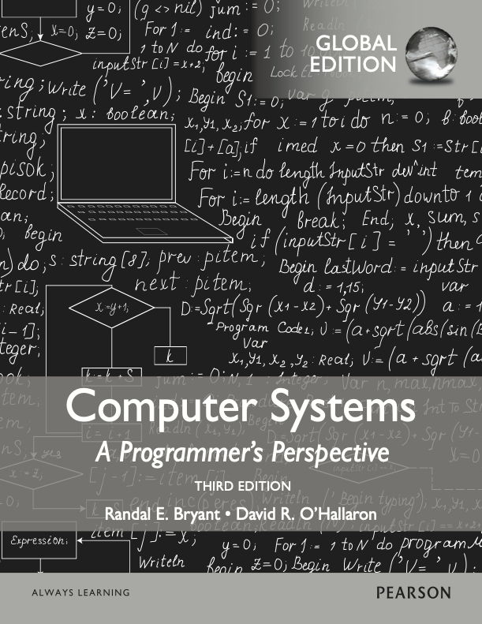

---
# 1. 기본 정보 및 SEO
title: "Computer Science"
description: "CS에 대해 공부한 내용을 정리"
slug: "/CS"
authors: unani

# 2. 작성일 및 상태 제어
date: 2026-11-18 06:04
draft: false

# 3. 사이드바 및 네비게이션 제어
sidebar_label: "[CS] Computer Science"
#sidebar_position: 1

# 4. 분류 및 메타데이터
tags: [Computer Science, Operating System, Linux, Windows, System Architecture]
keywords:
  [Computer Science, Operating System, Linux, Windows, System Architecture]
image: "./src/CSAPP.png"
---

# Computer Science

CS의 하위 문서들은 CS의 교과서로 불리는 Randal E. Bryan의 Computer Systems: A Programmer's Perspective(CS:APP)을 공부하며 작성한 글이다.

---

Computer Systems: A Programmer's Perspective

{/*truncate*/}
