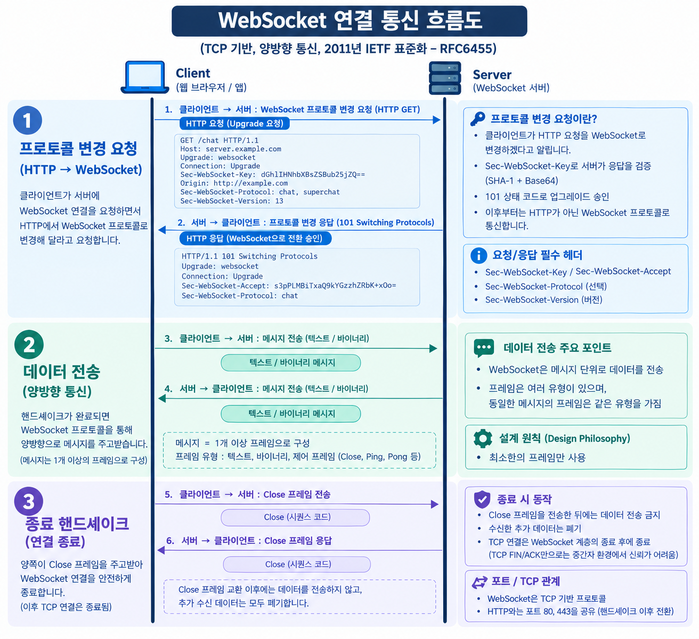

---
# 1. 기본 정보 및 SEO
title: "WebSocket - RFC6455 : The WebSocket Protocol"
description: "웹소켓 프로토콜의 표준 문서 파헤치기"
slug: "/websocket"

# 2. 작성일 및 상태 제어
date: 2026-09-22 09:00
draft: false

# 3. 사이드바 및 네비게이션 제어
# sidebar_label: ""
sidebar_position: 0

# 4. 분류 및 메타데이터
tags: [network, protocol, http, websocket, IETF, rfc6455,]
keywords: [network, protocol, http, websocket, IETF, rfc6455,]
# image: ""
---

# WebSocket - TFC6455 : The WebSocket Protocol

웹소켓( WebSocket)은 TCP 연결로 양방향 통신을 할 수 있도록 하는 통신 프로토콜로 2011 IETF에 의해 표준화 되었다.

---
<p align='center'>
[웹소켓 공식 문서(rfc6455) 보기](https://www.rfc-editor.org/rfc/rfc6455.html)
</p>

{/*truncate*/}

---

## Abstract

WebSocket 기술의 목표는 여러 개의 HTTP연결을 사용하지 않고도 서버와 양방향 통신이 필요한 애플리케이션에 매커니즘을 제공하는것이다. WebSocket 프로토콜은 TCP 계층을 기반으로 핸드셰이크와 기본 메시지 프레임으로 구성된다.

## Introduction

WebSocket의 연결의 흐름은 다음과 같다.
<p align='center'></p>

---

### Background

기존의 웹 애플리케이션에서는 클라이언트와 서버 간의 데이터 교환이나 상태 변경이 필요할 때마다 HTTP 요청을 보내야 했다. 이로 인해 서버와 클라이언트가 실시간으로 데이터를 주고받기 위해 <ins style={{color: 'red'}}>반복적인 HTTP 요청을 발생</ins>시키는 문제가 있었다.

<p align='center'>**다음과 같은 문제가 발생**</p>
1. 서버는 요청과 수신에 서로 다른 TCP 연결을 사용해야 했다.
2. 클라이언트에서 서버로 보내는 각각의 메시지에 HTTP 헤더가 포함되기 때문에 오버헤드가 크다. \
(네트워크 대역폭과 처리 리소스의 낭비)
3. 클라이언트 측에서는 요청에 대한 응답이 어떤 요청에 대한 응답이었는지 알기 위해 미핑 정보를 갖고 있어야 했다. \
(여러개의 요청을 보냈으면 그 응답의 결과가 어떤 요청에 대한 응답인지 알고 있어야 한다.)

이러한 문제의 해결책은 양방향 트래픽에 하나의 TCP 연결을 사용하도록 하는것이다.
WSAPI(WebSocket API)를 사용하면 기존의 양방향 통신을 위해 HTTP를 남용하는것을 막을 수 있다.

웹소켓 프로토콜은 기존 HTTP를 기반으로한 인프라를 사용하도록 양방향 통신기술을 사용하도록 설계 됐다.
(HTTP 포트 80, 443 포트를 통해 동작하도록 설계)

---

### Protocol Overview

웹소켓 프로토콜은 핸드셰이크와 데이터 전송. 이 두 가지 부분으로 나뉜다.

<p align='center'>**[클라이언트 측 handshake]**</p>
<p align='center'>WebSocket 연결을 위해 서버로 보내는 요청</p>

`Shell`

``` Shell
GET /chat HTTP/1.1
Host: server.example.com
Upgrade: websocket
Connection: Upgrade
Sec-WebSocket-Key: dGhlIHNhbXBsZSBub25jZQ==
Origin: http://example.com
Sec-WebSocket-Protocol: chat, superchat
Sec-WebSocket-Version: 13
```

`Shell`

``` Shell
/chat 경로로 HTTP(HTTP/1.1 버전으로) GET 요청을 보낸다
server.example.com 호스트(서버)에 요청을 보낸다.
websocket 프로토콜로 전환하겠다는 요청
현재 연결에서 프로토콜을 변경을 요청(HTTP -> WebSocket)
핸드셰이크 검증에 사용되는 값 : dGhlIHNhbXBsZSBub25jZQ==
클라이언트 정보(프로토콜, 주소, 포트에 대한 정보)
클라이언트가 지원하는 서브 프로토콜에 대한 정보(Chat, superchat의 서브 프로토콜을 지원함 -> 서버는 해당 프로토콜로 응답해야 함)
클라이언트가 사용하는 WebSocket 프로토콜의 버전 : 13
```

<p align='center'>**[서버 측 handshake]**</p>
<p align='center'>클라이언트로부터 받은 요청에 대한 응답</p>

`Shell`

``` Shell
HTTP/1.1 101 Switching Protocols
Upgrade: websocket
Connection: Upgrade
Sec-WebSocket-Accept: s3pPLMBiTxaQ9kYGzzhZRbK+xOo=
Sec-WebSocket-Protocol: chat
```

`Shell`

```  Shell
HTTP 프로토콜에서 다른 프로토콜로 변경한다.
변경되는 프로토콜은 websocket 이다.
연결 프로토콜을 업그레이드(전환)한다.
WebSocket 핸드셰이크 요청을 서버가 승인했음을 나타냄 : s3pPLMBiTxaQ9kYGzzhZRbK+xOo=
chat이라는 서브 프로토콜을 사용
```

핸드셰이크에 성공하면 웹소켓 프로토콜을 통한 양방향 통신이 가능해진다.
데이터 전송 시에는 `Message`라는 논리적 단위를 사용한다. \
(웹소켓의 `Message`는 네트워크를 통해 실제 전송되는 `Frame`과는 다른 개념으로, 하나의 큰 메시지는 1개 이상의 프레임으로 쪼개져 전송될 수 있다.)

`Frame`에는 여러 유형이 있다. `Text`나 `Binary` 같은 데이터 프레임은 메시지가 길 경우 여러 개의 프레임으로 나뉘어 전송될 수 있으며, 이외에도 연결 유지 및 제어를 위한 제어 프레임(`Ping`, `Pong`, `Close` 등)이 존재한다.

---

### Opening Handshake

서버가 웹소켓 핸드셰이크 요청을 정상적으로 처리했는지 클라이언트가 보증받을 수 있도록, 서버는 클라이언트로 받은 요청을 기반으로 응답을 생성해야 한다.
이를 통해 잘못된 프로토콜 접근을 방지하고 핸드셰이크의 무결성을 검증한다.

1. 서버의 Sec-WebSocket-Accept 응답 생성 과정
   1. **Key 추출** \
   클라이언트가 보낸 요청 헤더의 `Sec-WebSocket-Key` 값을 가져온다.
   2. **GUID 결합** \
   추출한 Key 뒤에 웹소켓 표준에 정의된 고정 GUID를 문자열로 이어붙인다.
   3. **해시 및 인코딩** \
   결합된 문자열에 대해 `SHA-1` 해시를 계산하고, 그 결과를 `Base64`로 인코딩한다.
   4. **응답 헤더에 추가** \
   생성된 값을 HTTP 응답의 `Sec-WebSocket-Accept` 필드에 포함해 클라이언트에 전송한다.

2. 클라이언트 응답 검증
   1. **상태 코드 검증** \
   HTTP 응답  상태 코드가 101(Switching Protocols)이 맞는지 확인
   2. **필수 헤더 검증** \
   응답에 `Sec-WebSocket-Accept` 헤더 누락 여부 확인
   3. **값 일치 여부 검증** \
   클라이언트가 직접 계산한 Accept 값과 서버가 보낸 `Sec-WebSocket-Accept`가 일치하는지 확인

---

### Closing Handshake

웹소켓은 연결을 강제로 끊지 않고, 웹소켓 애플리케이션 계층에서 `Close` 프레임을 교환해 안전하게 연결을 종료한다.

1. 종료 핸드셰이크가 필요한 이유
   1. TCP 종료(`FIN`/`ACK`)의 한계 \
   프록시(Proxy)나 중간 네트워크 장비가 있는 환경에서 E2E(End-to-End) 신뢰성이 보장되지 않을 수 있다.
   2. 애플리케이션 데이터 손실 방지 \
   TCP 네트워크 수신 버퍼에 애플리케이션이 읽지 않은 데이터가 남아 있는 상태에 소켓을 닫으면 데이터가 손실된다. \
   웹소켓은 양측이 서로 `Close` 프레임을 주고 받은 뒤 연결을 종료함으로써 데이터 손실을 예방한다.

2. 클로징 핸드셰이크 동작 방식
   1. `Close` 프레임 전송 \
   연결을 종료하려는 쪽은 종료 송태코드(Status Code)와 `Close` 제어 프레임을 전송한다.
   2. 응답 및 데이터 차단 \
      1. `Close`프레임을 전송한 측은 그 이후 데이터를 전송하지 않는다.
      2. `Close`프레임을 수신한 측은 이에 대한 응답으로 `Close`프레임을 회신한다.

3. 데이터 폐기 \
   `Close`프레임을 수신한 이후 들어오는 모든 추가 데이터는 폐기한다.

4. TCP 연결 종료 \
   양측이 `Close`프레임을 모두 교환한 후 TCP 연결이 종료된다.

---

### Design Design Philosophy

웹소켓 프로토콜은 최소한의 프레임만 사용해야 한다는 원칙에 따라 설계됐다.

- 데이터 프레임 : `Text`, `Binary`, `Continuation`
- 제어 프레임 : `Close`, `Ping`, `Pong`

---

### Security Model

웹소켓 프로토콜은 일반 HTTP 요청과 달리 핸드셰이크를 사용해 기존 프로토콜과의 혼동을 방지한다.
또한, 클라이언트가 서버로 보내는 모든 프레임에 마스킹을 적용해 중간 프록시 서버에서 캐시 포이즌(Cache Poisoning) 등의 공격을 어렵게 만들도록 설계됐다.

---

### Relationship to TCP and HTTP

웹소켓은 TCP 연결을 기반으로 통신하는 프로토콜이며 HTTP 통신과는 80, 443 포트를 공유한다. \
(핸드셰이크 이후 HTTP에서 웹소켓 프로토콜으로 전환)
